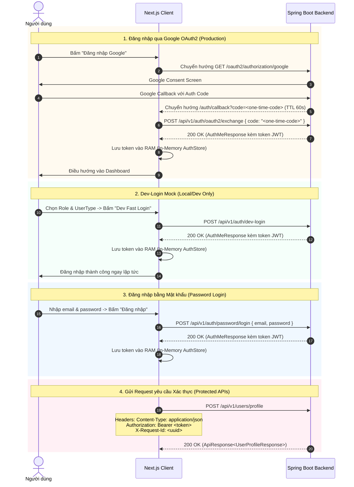

# Frontend - Backend Communication Contract & Core Foundation (2026)

Tài liệu này xác định các quy tắc kiến trúc, giao thức truyền thông, chuẩn hóa envelope và cơ chế bảo mật giữa **Mentify Frontend (Next.js 15+ App Router, TypeScript)** và **Mentify Backend (Spring Boot 4 / Java 21)** dựa trên cơ chế xác thực **Stateless JWT**.

---

## 1. Môi trường & Giao thức mạng (Network & Environments)

### 1.1. Base URLs & Dev Proxy
- **Backend Local**: `http://localhost:8080`
- **Frontend Local**: `http://localhost:3000`
- **Cấu hình Next.js Rewrites**:
  Nhằm giải quyết vấn đề CORS trên trình duyệt khi phát triển cục bộ và cho phép Frontend gọi trực tiếp tới Backend qua cùng một origin:
  ```ts
  // next.config.ts
  const nextConfig: NextConfig = {
    async rewrites() {
      return [
        {
          source: '/api/:path*',
          destination: `${process.env.NEXT_PUBLIC_BACKEND_INTERNAL_URL || 'http://localhost:8080'}/api/:path*`,
        },
        {
          source: '/oauth2/:path*',
          destination: `${process.env.NEXT_PUBLIC_BACKEND_INTERNAL_URL || 'http://localhost:8080'}/oauth2/:path*`,
        },
      ];
    },
  };
  ```
- **API Versioning**:
  - Backend cung cấp các endpoint theo chuẩn `/api/v1/**` (có alias `/api/**`).
  - Frontend quy ước gọi theo chuẩn `/api/v1/**`.

### 1.2. Múi giờ & Chuẩn thời gian (Timezone & Date Contract)
- **Múi giờ nghiệp vụ**: Luôn hiển thị và định dạng theo **`Asia/Ho_Chi_Minh`** (UTC+07:00).
- **Audit Timestamps**: Dữ liệu thời gian trả về từ API Backend luôn tuân thủ chuẩn ISO 8601 kèm explicit offset `+07:00` (ví dụ: `2026-10-02T21:30:00+07:00`).
- **Quy tắc Frontend**:
  - Không tự ý cộng/trừ 7 tiếng thủ công.
  - Sử dụng hàm tiện ích `formatVietnamDateTime` hoặc `Intl.DateTimeFormat` với `timeZone: 'Asia/Ho_Chi_Minh'`.
  - Không tự động thay đổi trạng thái booking/phiên hẹn bằng timer client; luôn refresh query hoặc đợi phản hồi từ Backend để đồng bộ.

---

## 2. Chuẩn hóa Envelope dữ liệu (Standard API Response & Error Contract)

Tất cả các API nghiệp vụ của Mentify đều được bọc trong cấu trúc phong bì nhất quán.

### 2.1. Phản hồi thành công (Success Response Envelope)
Áp dụng cho mọi API trả về mã HTTP `2xx`:

```typescript
export interface ApiResponse<T> {
  success: true;
  data: T;
  meta: PageMeta | null; // Null đối với single object / non-paginated lists
  timestamp: string;     // ISO 8601 offset +07:00
  requestId: string;     // UUID truy vết tương ứng X-Request-Id header
}

export interface PageMeta {
  page: number;          // 0-based index (bắt đầu từ 0)
  size: number;          // Kích thước trang (> 0)
  totalItems: number;    // Tổng số bản ghi thỏa điều kiện
  totalPages: number;    // Tổng số trang (làm tròn lên, = 0 khi totalItems = 0)
}
```

### 2.2. Phản hồi lỗi nghiệp vụ (Error Response Envelope)
Áp dụng cho mọi phản hồi lỗi `4xx` và `5xx`:

```typescript
export interface ApiErrorDetail {
  field: string;         // Tên trường bị lỗi validation (ví dụ: "email", "schoolId")
  message: string;       // Thông điệp lỗi chi tiết cho trường đó
}

export interface ApiErrorBody {
  code: ApiErrorCode;    // Mã định danh lỗi chuẩn
  message: string;       // Thông báo lỗi thân thiện hiển thị cho người dùng
  details?: ApiErrorDetail[] | null; // Danh sách chi tiết (nếu có, ví dụ validation)
}

export interface ApiErrorResponse {
  success: false;
  error: ApiErrorBody;
  timestamp: string;
  requestId: string;
}

export type ApiErrorCode =
  | 'VALIDATION_ERROR'     // 400: Dữ liệu gửi lên không đúng định dạng
  | 'UNAUTHENTICATED'      // 401: Thiếu token, token không hợp lệ hoặc đã hết hạn
  | 'FORBIDDEN'             // 403: Không có quyền truy cập thao tác này
  | 'RESOURCE_NOT_FOUND'    // 404: Không tìm thấy tài nguyên
  | 'CONFLICT'              // 409: Xung đột trạng thái (hạ cấp UserType, trùng lịch booking)
  | 'INTERNAL_ERROR'        // 500: Lỗi hệ thống nội bộ máy chủ
  | (string & {});          // Mở rộng cho các mã lỗi domain-specific khác
```

### 2.3. Request Tracing (`X-Request-Id`)
- Mỗi request gửi đi từ Frontend client được tự động gắn header `X-Request-Id` (UUID v4 ngẫu nhiên).
- Backend giữ nguyên ID này hoặc cấp phát nếu chưa có.
- Trong trường hợp xảy ra lỗi, `requestId` được hiển thị trong toast/thông báo lỗi để người dùng có thể gửi bộ phận hỗ trợ kỹ thuật tra cứu logs.

---

## 3. Cơ chế Xác thực Stateless JWT & Bảo mật (JWT Security Handshake)

Mentify sử dụng kiến trúc **Stateless JWT Authentication**. Toàn bộ yêu cầu bảo vệ danh tính gửi kèm qua HTTP header `Authorization: Bearer <token>`. Hệ thống không sử dụng cookie session (`JSESSIONID`) hay token CSRF.



### 3.1. Quản lý Token trên Client
1. **Lưu trữ an toàn**: Token được lưu trữ độc quyền trong bộ nhớ JavaScript RAM (Zustand store). Tuyệt đối **không** lưu vào `localStorage`, `sessionStorage` hay cookies.
2. **Thời hạn (TTL)**: Access token có hiệu lực trong 15 phút.
3. **Xử lý khi hết hạn**: Khi token hết hạn hoặc Backend trả `401 UNAUTHENTICATED`, HTTP Client tự động xóa token và chuyển trạng thái người dùng về Guest để yêu cầu đăng nhập lại.

### 3.2. Cấu trúc thông tin người dùng (`AuthMeResponse`)
```typescript
export interface AuthMeResponse {
  id: string;
  email: string;
  userType: UserType;
  role: UserRole;
  accountStatus: AccountStatus;
  mentorStatus: MentorStatus;
  acceptingBookings: boolean;
  fullName: string | null;
  avatarUrl: string | null;
  token?: AuthTokenResponse | null;
}

export interface AuthTokenResponse {
  value: string;
  tokenType: string; // 'Bearer'
  expiresAt: string; // ISO 8601
}
```

- **Quy tắc phân quyền**:
  - `role`: Chỉ gồm `USER` và `ADMIN`. `MENTOR` **không phải là role hệ thống**.
  - Quyền nhận booking phụ thuộc vào: `mentorStatus === 'APPROVED' && acceptingBookings === true`.

### 3.3. Đăng xuất (Logout)
- Frontend gọi `POST /api/v1/auth/logout` kèm header `Authorization: Bearer <token>`.
- Frontend xóa token khỏi bộ nhớ RAM và xóa toàn bộ bộ đệm cache TanStack Query (`queryClient.clear()`).

---

## 4. Danh mục Master Data & Tối ưu Caching (Master Data Contract)

### 4.1. Danh mục Trường Đại học (`GET /api/v1/master-data/schools`)
- Query parameters: `search`, `region`, `campusType` (`MAIN_CAMPUS` | `BRANCH_CAMPUS`), `page`, `size`.
- Response: `ApiResponse<School[]>` với `meta: PageMeta`.

### 4.2. Danh mục Nhóm ngành chuẩn Thông tư 74/2026 (`GET /api/v1/master-data/major-groups`)
- Query parameters: `search`, `isActive`.
- Response: `ApiResponse<MajorGroup[]>`.
- Frontend sử dụng trường `code` (chuỗi 4 chữ số, ví dụ `"4801"`, `"4802"`) để lưu vào hồ sơ cá nhân (`UpdateProfileRequest.majorGroupCode`).

### 4.3. Chiến lược Caching với TanStack Query
- **Master Data**: `staleTime: 1000 * 60 * 30` (30 phút), `gcTime: 1000 * 60 * 60` (1 giờ).
- **User Thông tin cá nhân (`auth/me`)**: `staleTime: 1000 * 60 * 5` (5 phút), tự động refetch khi window focus.
- **Cache Invalidation**:
  - Sau khi gọi mutation cập nhật profile (`PUT /api/v1/users/profile`), lập tức invalidate:
    + `['auth', 'me']`
    + `['user', 'profile']`
  - Sau khi đăng xuất (`POST /api/v1/auth/logout`), reset toàn bộ cache của TanStack Query: `queryClient.clear()`.

---

## 5. Quy tắc Bảo mật & Kiểm soát rò rỉ dữ liệu (Client-side Security)

1. **Tuyệt đối không lưu Access Token hoặc Credential vào `localStorage` / `sessionStorage` / Cookies**:
   Toàn bộ access token được lưu trữ an toàn trong RAM bộ nhớ ứng dụng.
2. **Không ghi Logs nhạy cảm ra Console**:
   Tuyệt đối không log URL meeting phòng học, signed URL tải minh chứng, token JWT hoặc thông tin định danh cá nhân của học sinh THPT vào `console.log`.
3. **Tuân thủ quy định bảo vệ dữ liệu cá nhân (PDPA) & Người giám hộ**:
   Đối với đối tượng `SCHOOL_STUDENT`, Frontend bắt buộc cung cấp giao diện điền thông tin người giám hộ (`guardianName`, `guardianContact`) khi thu thập chấp thuận pháp lý (`POST /api/v1/users/consent`).
